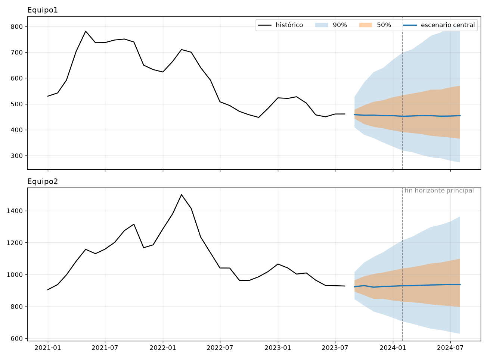

# Pronóstico de costos de equipos para un proyecto de construcción

Aquí está mi solución al caso: analicé qué materias primas determinan el costo de dos equipos críticos, hice un pronóstico mensual con intervalos de confianza y construí un agente de IA en Azure que responde preguntas sobre los resultados y los complementa con noticias del mercado.

- **Informe completo:** [reports/informe.md](reports/informe.md)
- **Presentaciones:** [técnica](reports/presentacion_tecnica.pdf) · [negocio](reports/presentacion_negocio.pdf)
- **Agente en línea:** https://app-dataknown-caso.azurewebsites.net
- **Arquitectura:** [infra/arquitectura_azure.png](infra/arquitectura_azure.png)

---

## Resultados principales

**1. El precio de cada equipo es una mezcla fija de sus insumos, en el mismo mes:**

| Equipo | Fórmula | Insumo dominante |
|---|---|---|
| Equipo1 | `0.2X + 0.8Y` | Y (Z no influye) |
| Equipo2 | `(X + Y + Z) / 3` | Z en términos de % de cambio |

R² de 0.9997 en ambos. La correlación de 0.85 entre Equipo1 y Z es espuria: desaparece al analizar los cambios mensuales.

> Por niveles y fechas, X parece corresponder al petróleo Brent y Z al aluminio (LME); Y no logré identificarla. Como es solo una hipótesis, mantuve los nombres originales del caso.

**2. El modelo:** elegí la regresión lineal después de comparar 8 modelos (0.27% de error en validación cruzada). Los modelos de árboles no pueden extrapolar y fallaron en el boom de commodities de 2021-2022.

**3. El pronóstico:** simulé 10,000 escenarios de las materias primas y pasé cada uno por la fórmula. Calibré los intervalos con un backtest.

| Horizonte | Error típico | Uso recomendado |
|---|---|---|
| 1-3 meses | 4-12% | Decisiones de compra |
| **6 meses** | **13-16%** | **Presupuesto con contingencia (horizonte recomendado)** |
| 7-12 meses | 20-25% | Escenarios |



---

## Estructura del repositorio

```
├── data/
│   ├── raw/                  # archivos originales, sin modificar
│   └── processed/            # series semanal y mensual, pronóstico a 12 meses
├── notebooks/
│   ├── 1_eda.ipynb                     # calidad de datos y outlier de Z
│   ├── 2_seleccion_variables.ipynb     # estacionariedad, regresión, rezagos, cointegración, fórmula
│   ├── 3_seleccion_modelo.ipynb        # 8 modelos, 3 finalistas, regresión lineal
│   └── 4_pronostico.ipynb              # backtest, simulación, calibración, horizonte
├── src/
│   └── datos.py              # lectura, validación y limpieza de los datos
├── agent/
│   ├── herramientas.py       # funciones que usa el agente
│   ├── agente.py             # ciclo del agente con Azure OpenAI
│   └── app.py                # interfaz en Streamlit
├── infra/
│   ├── deploy_app.sh         # despliegue en Azure App Service
│   └── arquitectura_azure.*  # diagrama de arquitectura
├── reports/
│   ├── informe.md                  # informe del caso
│   ├── presentacion_tecnica.pdf    # presentación técnica
│   ├── presentacion_negocio.pdf    # presentación para dirección
│   └── figures/                    # gráficas generadas por los notebooks
├── .env.example              # plantilla de variables de entorno del agente
└── .streamlit/config.toml    # tema visual de la app
```

---

## Cómo reproducirlo

### 1. Instalar dependencias

```bash
pip install -r requirements.txt
```

### 2. Correr los notebooks en orden

`1_eda` -> `2_seleccion_variables` -> `3_seleccion_modelo` -> `4_pronostico`

Cada notebook lee los resultados del anterior desde `data/processed/`. El notebook 4 genera `data/processed/pronostico_12m.csv`, que usa el agente.

### 3. Correr el agente localmente

Crea un archivo `.env` en la raíz (está excluido de Git) a partir de `.env.example`:

```
AZURE_OPENAI_ENDPOINT=https://<tu-recurso>.openai.azure.com/
AZURE_OPENAI_API_KEY=<tu-key>
AZURE_OPENAI_DEPLOYMENT=gpt-5.4-mini
```

```bash
streamlit run agent/app.py
```

Prueba rápida desde la terminal:

```bash
python agent/agente.py "Si Y sube 15%, ¿cuánto impacta a cada equipo?"
```

### 4. Desplegar en Azure

Requiere Azure CLI con sesión iniciada (`az login`) y un recurso de Azure OpenAI con el modelo desplegado.

```bash
APP_NAME=<nombre-unico> bash infra/deploy_app.sh
```

El script crea el App Service, configura las variables de entorno leyendo la key directamente de Azure (nunca del repositorio) y sube solo los archivos que necesita la app.

---

## El agente

| Herramienta | Qué hace |
|---|---|
| `consultar_pronostico` | Pronóstico mensual con percentiles P5-P95 |
| `consultar_historico` | Precios observados recientes, mínimo y máximo histórico |
| `simular_escenario` | Impacto en los equipos si una materia prima sube o baja un % |
| `resultados_modelo` | Fórmula, elasticidades, métricas, horizonte y comparación de incertidumbre |
| `buscar_noticias` | Noticias recientes del mercado en la web |

El LLM solo interpreta la pregunta y redacta la respuesta. Los números, los escenarios y las comparaciones los calcula el código en Python, para que el agente no invente cifras (en el informe cuento los errores que me llevaron a hacerlo así).

---

## Tecnologías

Python, pandas, statsmodels, scikit-learn, Streamlit, Altair, Azure OpenAI (`gpt-5.4-mini`), Azure App Service, Azure CLI

