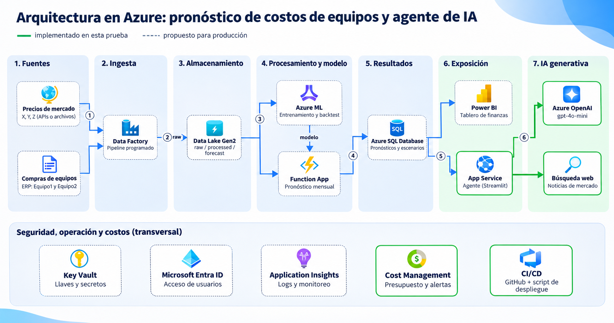
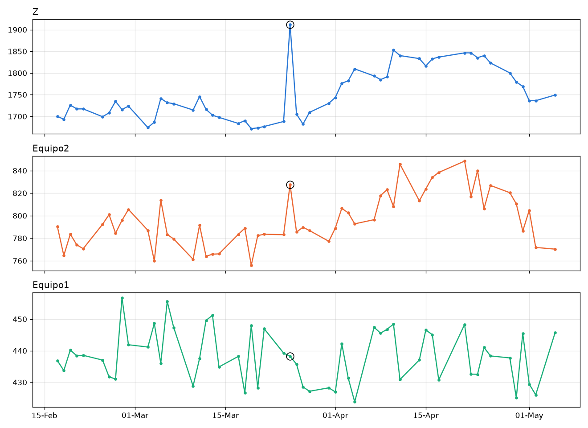
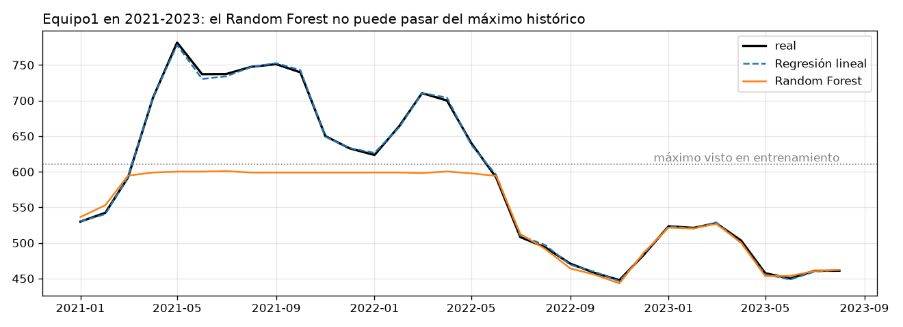
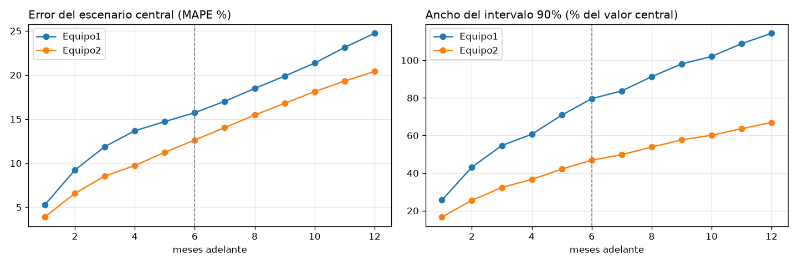
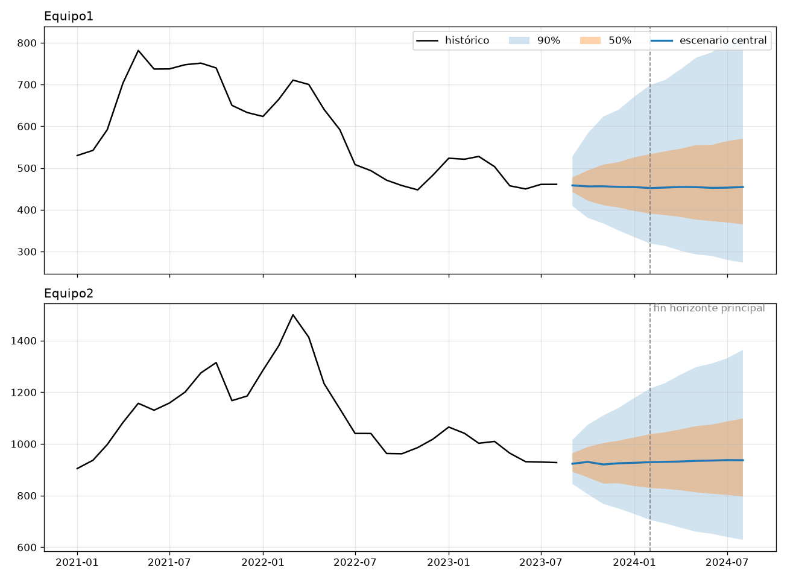

# Informe: Gestión de costos operativos en un proyecto de construcción

**Autora:** Martha Patricia Ortiz
**Repositorio:** notebooks, código, agente y arquitectura en este mismo repo
**Agente en línea:** https://app-dataknown-caso.azurewebsites.net

---

## 1. Explicación del caso

Una constructora necesita comprar dos tipos de equipos críticos (Equipo1 y Equipo2) durante la ejecución de un proyecto. El costo de esos equipos ha variado sin que la empresa logre anticiparlo, y eso le ha generado desviaciones en el presupuesto. La gerencia sospecha que el precio depende de algunas materias primas, pero no sabe de cuáles ni cuánto.

Recibí cuatro archivos:

| Archivo | Contenido | Periodo |
|---|---|---|
| `X.csv` | Precio diario de la materia prima X | jun-1988 a abr-2024 |
| `Y.csv` | Precio diario de la materia prima Y | jul-2006 a sep-2023 |
| `Z.csv` | Precio diario de la materia prima Z | ene-2010 a ago-2023 |
| `historico_equipos.csv` | X, Y, Z y precio de Equipo1 y Equipo2 | ene-2010 a ago-2023 (3,530 días hábiles) |

Lo que me pidieron, en mis palabras:

1. Identificar qué materias primas explican el precio de cada equipo y cuáles son ruido.
2. Proponer un método reproducible para estimar el costo de los equipos.
3. Proyectar el costo de los próximos meses con su incertidumbre y justificar el horizonte.
4. Presentar los resultados con un agente de IA que además incorpore información del mercado.
5. Diseñar la arquitectura en la nube para operar la solución.

---

## 2. Supuestos

- **El precio de compra relevante es el promedio mensual.** La planeación financiera del proyecto es mensual, y el promedio reduce el ruido diario.
- **La relación entre insumos y equipos es estable en el tiempo.** Lo verifiqué: los coeficientes casi no cambian entre periodos (sección 4).
- **Todos los precios están en la misma moneda y en términos nominales.** No hay información para deflactarlos.
- **No hay información sobre el futuro de las materias primas** (contratos, curvas de futuros). Por eso el pronóstico de los insumos se basa solo en su comportamiento histórico.
- **El dato de Z del 2014-03-25 es un error de captura** y no un evento de mercado (sección 4.1).
- **Identidad de las materias primas (hipótesis, no afecta el modelo).** Por sus niveles y fechas, X se parece al petróleo Brent (máximo de 146.08 el 3 de julio de 2008, caída a 19.33 el 21 de abril de 2020) y Z al precio cash del aluminio en la LME (máximo de US$3,984 el 7 de marzo de 2022). No logré identificar Y. Uso esta hipótesis solo para buscar noticias de mercado.
- **La ventana del proyecto no está definida.** Proyecto 12 meses y recomiendo usar los primeros 6 (sección 5).

---

## 3. Formas para resolver el caso y la opción tomada en esta prueba

### 3.1 Alternativas que consideré

| Alternativa | Ventaja | Por qué no (o por qué sí) |
|---|---|---|
| Pronosticar cada equipo directamente con una serie de tiempo (ARIMA, suavizamiento) | Simple | Ignora a las materias primas, no permite hacer escenarios ni explica de dónde viene el costo |
| Promedio móvil de los últimos meses | Muy fácil de operar | En el backtest fue el peor método a horizontes cortos (sección 5.1) |
| Modelos de machine learning (Random Forest, Gradient Boosting, etc.) | Capturan relaciones no lineales | No pueden predecir valores fuera del rango que vieron al entrenar; en el boom de 2021-2022 fallaron (sección 4.4) |
| VAR / VECM | Modela todas las series juntas | Más complejo de lo necesario una vez que encontré una relación casi exacta |
| **Modelo estructural en dos pasos** | Explica el costo con sus insumos, permite escenarios y es auditable | **Opción elegida** |

### 3.2 La opción que tomé

1. **Selección de variables:** pruebas de estacionariedad, correlación en niveles y en retornos, regresión con errores HAC, rezagos y cointegración, para saber qué insumos importan y si hay retraso.
2. **Modelo de costo:** regresión lineal del precio de cada equipo sobre sus insumos en el mismo mes. La elegí después de comparar 8 modelos.
3. **Pronóstico de insumos:** simulación de 10,000 escenarios de X, Y y Z remuestreando sus cambios mensuales históricos en bloques, calibrada con un backtest.
4. **Costo proyectado:** paso cada escenario de insumos por el modelo de costo y obtengo el rango de costos de cada equipo.
5. **Agente de IA:** un agente sobre Azure OpenAI que consulta estos resultados, simula escenarios y busca noticias.
6. **Nube:** el agente está desplegado en Azure App Service y la arquitectura de producción está documentada.

### 3.3 Modelo de IA convencional vs. agente de IA

Un **modelo de IA convencional** recibe una entrada y devuelve una salida, siempre de la misma forma. En este proyecto la regresión es eso: recibe los precios de X, Y y Z y devuelve el costo de cada equipo. No decide nada.

Un **agente de IA** tiene un objetivo y decide cómo alcanzarlo. El que construí recibe una pregunta en lenguaje natural, decide qué herramientas necesita, las ejecuta, revisa los resultados y redacta la respuesta.

| Concepto | Qué significa | Cómo se ve en mi agente |
|---|---|---|
| Autonomía | Decide los pasos sin que se los indiquen | Elige entre 5 herramientas y el orden en que las usa |
| Uso de herramientas | Ejecuta funciones externas | Consultar pronóstico, consultar histórico, simular escenarios, resumen de la metodología y búsqueda de noticias |
| Memoria | Recuerda el contexto | Responde preguntas de seguimiento como "¿y si además Z baja 10%?" |
| Capacidad de acción | Hace, no solo responde | Corre simulaciones y búsquedas antes de contestar |

### 3.4 Arquitectura en la nube

Lo que implementé (borde verde): Azure OpenAI con `gpt-5.4-mini` en modalidad Data Zone (procesamiento dentro de EE. UU.), el agente en App Service, búsqueda web de noticias, presupuesto con alertas en Cost Management y despliegue reproducible con `infra/deploy_app.sh`. La key del modelo nunca está en el código: se lee de la configuración de Azure.

Para producción propongo (borde punteado): Data Factory para la ingesta, Data Lake Gen2 con zonas raw/processed/forecast, Azure ML para entrenar y registrar el modelo, una Function App que genere el pronóstico cada mes, Azure SQL y Power BI para finanzas, y Key Vault, Entra ID y Application Insights para seguridad y monitoreo.

---

## 4. Resultados del análisis de los datos y los modelos

### 4.1 Calidad de los datos (notebook 1)

- Los cuatro archivos venían en formatos distintos: X en orden descendente; Y con `;` como separador, coma decimal y fechas dd/mm/aaaa; Z con las columnas al revés. Los normalicé en `src/datos.py`.
- X, Y y Z dentro de `historico_equipos.csv` coinciden al 100% con sus archivos originales.
- Sin nulos ni fechas duplicadas. Y no cambia de precio en el 55% de los días: se mueve en escalones.
- **Un dato erróneo:** Z vale 1,911.97 el 2014-03-25 (+13%) y regresa a 1,705 al día siguiente. El resto de la serie son múltiplos de 0.25. Revisé las noticias de esa semana y el aluminio se movió menos de 1% ese día, así que no fue un evento de mercado.
- **El dato erróneo dio la primera pista:** Equipo2 también subió ese día (de 783 a 828, +6%) y Equipo1 no. El precio de Equipo2 se calcula con el Z del mismo día. Excluí ese día completo en lugar de interpolarlo, para no modificar el precio del equipo ni inventar valores.

### 4.2 Qué materias primas importan (notebook 2)

**Estacionariedad.** Ninguna serie es estacionaria en niveles y todas lo son en retornos (pruebas ADF y KPSS). Por eso la correlación en niveles engaña:

| Correlación | En niveles | En retornos mensuales |
|---|---|---|
| Equipo1 vs Z | 0.85 | 0.44 |
| Equipo2 vs Y | 0.92 | 0.65 |

Buena parte de la correlación en niveles viene de que todos los commodities suben y bajan juntos con el ciclo económico.

**Regresión en retornos mensuales** (errores HAC):

| | X | Y | Z | R² |
|---|---|---|---|---|
| Equipo1 | 0.024 | 0.966 | 0.002 (p = 0.86) | 0.993 |
| Equipo2 | 0.031 | 0.201 | 0.763 | 0.989 |

Z no influye en Equipo1, aunque en niveles su correlación era 0.85.

**Frecuencia.** Con datos semanales el R² baja a ~0.78. El precio diario de los equipos tiene ruido propio que el promedio mensual cancela, así que trabajé en frecuencia mensual.

**Rezagos.** Ningún rezago de 1 a 3 meses fue significativo: los equipos reaccionan a sus insumos en el mismo mes. Esto tiene una consecuencia práctica: no hay meses "gratis" de pronóstico, y para proyectar los equipos primero hay que proyectar las materias primas.

**Cointegración** (Engle-Granger):

| Relación | p-value |
|---|---|
| Equipo1 ~ Y | 0.207 |
| Equipo1 ~ X + Y | < 0.001 |
| Equipo2 ~ Y + Z | 0.351 |
| Equipo2 ~ X + Y + Z | 0.001 |

X mueve poco a los equipos en porcentaje, pero sin X la relación de largo plazo no cierra. X se queda.

### 4.3 La fórmula del costo

Al estimar la relación directamente en precios, los coeficientes resultaron prácticamente fracciones exactas:

| | X | Y | Z | Constante | R² |
|---|---|---|---|---|---|
| Equipo1 | 0.198 | 0.801 | 0.000 (p = 0.90) | 0.03 (p = 0.96) | 0.9997 |
| Equipo2 | 0.336 | 0.335 | 0.332 | 0.67 (p = 0.53) | 0.9997 |

> **Equipo1 = 0.2X + 0.8Y**
> **Equipo2 = (X + Y + Z) / 3**

La prueba conjunta no rechaza que la constante sea cero y que los pesos sumen 1 (p = 0.98 y 0.77). El precio de cada equipo se comporta como una receta de insumos.

Esto también explica por qué X parecía marginal en la regresión de retornos. Su peso en la fórmula es de 20% y 33%, pero su precio (~78) es mucho menor que el de Y (~555) o Z (~2,040). Por eso su efecto en porcentaje es chico. Con los precios más recientes, las elasticidades son:

| % de cambio del equipo por cada 1% de cambio en | X | Y | Z |
|---|---|---|---|
| Equipo1 | 0.04 | 0.97 | 0 |
| Equipo2 | 0.03 | 0.20 | 0.76 |

### 4.4 Selección del modelo (notebook 3)

**Etapa 1.** Comparé 8 modelos con validación cruzada para series de tiempo (`TimeSeriesSplit`, 5 cortes de 18 meses, siempre entrenando con el pasado y probando con el futuro):

| Modelo | MAPE promedio |
|---|---|
| Lasso | 0.26% |
| Ridge | 0.27% |
| Regresión lineal | 0.27% |
| Gradient Boosting | 2.50% |
| Random Forest | 3.04% |
| Árbol de decisión | 3.70% |
| SVR | 3.82% |
| KNN | 4.87% |

**Etapa 2.** A los tres finalistas los probé entrenando hasta 2020 y pronosticando 2021-2023, cuando los precios llegaron a niveles que no existían antes (Equipo1: máximo de 610 en entrenamiento contra 782 en prueba). Los tres lineales mantuvieron un error de ~0.3%. El Random Forest se quedó topado en el máximo histórico y su error subió a 6.6%.

Los coeficientes de los tres lineales son prácticamente iguales y estables entre cortes. Ridge eligió una regularización mínima, señal de que no hay sobreajuste que corregir. Lasso eliminó Z en Equipo1, la misma conclusión del notebook 2.

**Elegí la regresión lineal:** empata en desempeño con Ridge y Lasso, no tiene hiperparámetros que recalibrar, sus coeficientes se leen directamente como la receta de cada equipo y permite inferencia estadística.

### 4.5 El agente de IA

El agente usa `gpt-5.4-mini` en Azure OpenAI y tiene 5 herramientas escritas en Python (`agent/herramientas.py`). La interfaz está hecha en Streamlit e incluye el chat, la gráfica interactiva del pronóstico y la explicación de modelo contra agente.

Al probarlo encontré tres errores que me ayudaron a definir un principio de diseño: **el LLM interpreta y redacta; los números y las comparaciones los calcula el código.**

1. **Peso contra elasticidad.** Al preguntarle por un alza de 10% en Z, el agente respondió que Equipo2 subiría 3.3% (un tercio de 10%). La respuesta correcta es 7.7%. Lo corregí obligándolo a usar la herramienta de simulación y dándole las elasticidades calculadas.
2. **Qué significa "hoy".** Al pedirle "los próximos 6 meses" tomaba meses de 2024, porque se guiaba por la fecha real. Le indiqué que, para el análisis, hoy es agosto 2023 (el último dato).
3. **Comparar incertidumbre.** Concluía que Equipo2 era más incierto, contra sus propios números. Ahora esa comparación la calcula el código y el agente solo la comunica.

---

## 5. Proyección de costos y horizonte de predicción

### 5.1 Pronóstico de las materias primas (notebook 4)

Hice un backtest con origen móvil: entrené con los primeros 6 años, pronostiqué 12 meses, avancé un mes y repetí (~80 pronósticos fuera de muestra por método).

| MAPE (%) | X 1m | X 6m | X 12m | Y 1m | Y 6m | Y 12m | Z 1m | Z 6m | Z 12m |
|---|---|---|---|---|---|---|---|---|---|
| Naive | 7.8 | 21.9 | 30.3 | 5.3 | 15.9 | 24.8 | 3.7 | 12.3 | 19.0 |
| Media móvil 3m | 11.3 | 22.3 | 29.9 | 8.1 | 16.9 | 26.6 | 5.6 | 13.3 | 19.7 |
| Drift | 7.9 | 22.9 | 32.1 | 5.3 | 16.7 | 26.8 | 3.7 | 12.9 | 20.3 |
| ARIMA(0,1,1) | 7.3 | 21.9 | 30.3 | 4.8 | 16.1 | 24.2 | 3.6 | 12.3 | 18.9 |

Ningún método supera claramente a "el precio se queda donde está", algo esperable en commodities. La media móvil de 3 meses es la peor a horizontes cortos, porque reacciona tarde a los cambios.

Por eso lo valioso no es un número puntual sino el rango. Para construirlo simulé 10,000 trayectorias de X, Y y Z remuestreando sus cambios mensuales históricos **en conjunto**, para conservar la correlación entre ellos, y en bloques de 3 meses. Luego pasé cada trayectoria por la fórmula de cada equipo.

### 5.2 Calibración de los intervalos

Un intervalo de 90% debería contener el valor real el 90% de las veces. En el backtest, sin ajuste, cubría solo ~75-81%. La razón es que la volatilidad mensual de X y Y subió después de 2016 (X de 7.3% a 10.0%; Y de 4.6% a 7.0%), y los primeros pronósticos solo conocían el periodo tranquilo.

Probé ampliar la volatilidad simulada. Con un factor de 1.3 la cobertura sube a ~87-89%. Con 1.45 llegaría a 90-92%, pero los rangos serían tan anchos que perderían utilidad para presupuestar. Me quedé con 1.3.

### 5.3 Horizonte de predicción

| Meses adelante | Error del escenario central (Equipo1 / Equipo2) | Ancho del rango de 90% |
|---|---|---|
| 1 | 5.3% / 3.9% | 26% / 17% del valor central |
| 3 | 11.9% / 8.5% | 55% / 32% |
| 6 | 15.7% / 12.6% | 80% / 47% |
| 12 | 24.7% / 20.4% | 114% / 67% |

El error crece de forma gradual, como en una caminata aleatoria. No hay un mes en que el modelo "se rompa", pero sí un punto en que el rango deja de servir para presupuestar. Mi criterio fue mantener el error típico en ~15%, un nivel razonable de contingencia para una obra:

- **1 a 3 meses:** error de 4-12%. Sirve para decisiones de compra concretas.
- **6 meses (horizonte recomendado):** error de 13-16%. Sirve para fijar presupuesto con contingencia.
- **7 a 12 meses:** error de 20-25%. Lo presento como escenario, no como pronóstico.

Como no hay rezagos, esperar no mejora el pronóstico. Lo que sí lo mejora es **actualizarlo cada mes**: el error a 1 mes es unas 3 veces menor que a 6.

### 5.4 Pronóstico

Último dato real: agosto 2023.

| Mes | Equipo1 P50 | Equipo1 rango 90% | Equipo2 P50 | Equipo2 rango 90% |
|---|---|---|---|---|
| sep-2023 | 458 | 409 a 528 | 923 | 845 a 1,015 |
| oct-2023 | 456 | 381 a 583 | 930 | 806 a 1,074 |
| nov-2023 | 456 | 367 a 624 | 920 | 767 a 1,111 |
| dic-2023 | 455 | 351 a 640 | 925 | 750 a 1,140 |
| ene-2024 | 454 | 335 a 671 | 927 | 729 a 1,179 |
| feb-2024 | 452 | 319 a 699 | 929 | 705 a 1,215 |

- **Equipo1 tiene más incertidumbre relativa** que Equipo2 (rango de 26% a 84% de su valor central, contra 18% a 55%), porque depende en 80% de Y, el insumo más volátil.
- **Escenarios:** si Y sube 15%, Equipo1 sube 14.4% y Equipo2 3.0%. Si Z baja 10%, Equipo2 baja 7.7% y Equipo1 no cambia.
- **Validación con datos reales:** `X.csv` trae datos hasta marzo 2024. Los 7 meses reales de X (sep-2023 a mar-2024) cayeron dentro del rango proyectado.

---

## 6. Futuros ajustes o mejoras

1. **Usar curvas de futuros** (por ejemplo, LME para el aluminio) en lugar de la simulación histórica para proyectar las materias primas. Incorporan las expectativas del mercado y es la mejora con más impacto esperado.
2. **Modelar la volatilidad en el tiempo** (GARCH o regímenes) en lugar de un factor fijo de 1.3, para que los rangos se ajusten solos en periodos de calma o de crisis.
3. **Automatizar el ciclo mensual** con Data Factory, Azure ML y una Function App, como propongo en la arquitectura.
4. **Comparación de proveedores:** contrastar cada cotización con el precio "justo" de la fórmula. Si una cotización cae fuera del rango, está cara. Esto responde directamente a uno de los beneficios esperados del caso.
5. **Alertas automáticas** cuando un insumo se mueva más de cierto umbral o cuando el costo real se salga del rango pronosticado.
6. **Agente:** pasar la búsqueda web a *Grounding with Bing* en Foundry Agent Service, mover la key a Key Vault con identidad administrada, agregar inicio de sesión con Entra ID y crear un set de preguntas de prueba para evaluar sus respuestas cada vez que se cambie el modelo o las instrucciones.
7. **Datos:** confirmar la identidad de X, Y y Z, agregar tipo de cambio e inflación si los precios se reportan en otra moneda, y registrar el costo real de cada compra para medir el error del pronóstico mes a mes.

---

## 7. Apreciaciones y comentarios del caso

- El hallazgo más interesante fue que el precio de los equipos es una receta casi exacta de sus insumos. Lo que parecía un problema de pronóstico complejo se reduce a dos preguntas: qué receta usa cada equipo y qué tan bien se puede anticipar cada materia prima. La segunda es la difícil, y la respuesta honesta es que a más de 6 meses el rango es amplio.
- El dato erróneo de Z terminó siendo útil: que Equipo2 lo reflejara y Equipo1 no fue la primera evidencia de la relación contemporánea.
- Para la parte de nube, la suscripción nueva no tenía cuota de App Service en la región principal y tuve que desplegar en West US 2. El primer despliegue también falló por tiempo de espera y lo resolví con despliegue asíncrono. Ambos están documentados en el script de despliegue.
